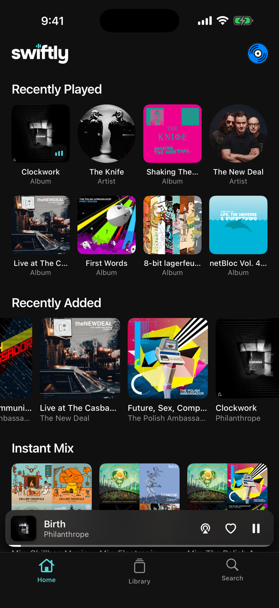
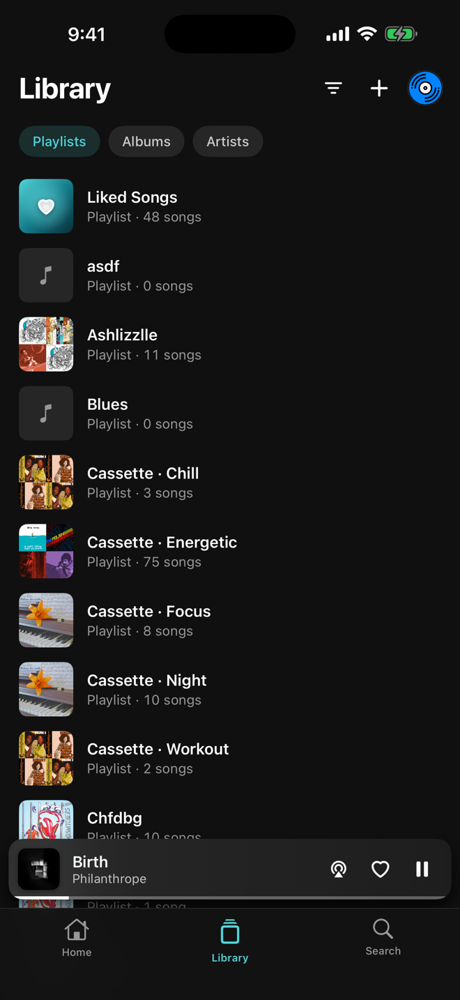
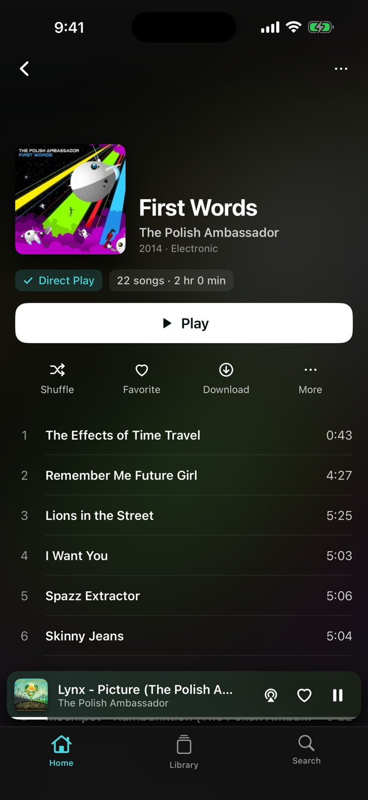
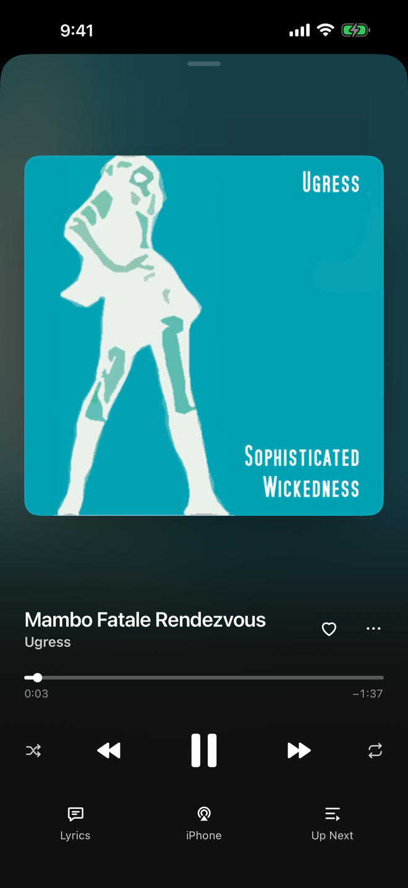
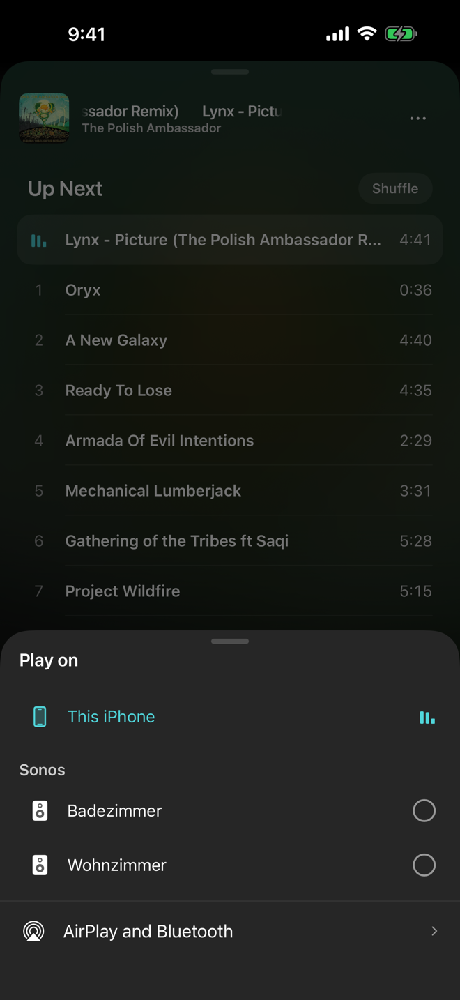

<div align="center">


# Swiftly Music

**A native music app for Jellyfin and Navidrome, on the iPhone.**
It plays the files on your server as they are — FLAC stays FLAC.

<br>

[](#requirements)
&nbsp;
[](LICENSE)
&nbsp;
[](https://jellyfin.org)
&nbsp;
[](https://www.navidrome.org)
&nbsp;
[](https://swiftlyplayer.com/music/)

<br>

[](https://testflight.apple.com/join/Ws5snXzX)
&nbsp;
[](https://discord.gg/MeGwfv3UwN)

<br>

</div>

<br>

**Swiftly Music is a music app for your own server.** Sign in to Jellyfin,
or to Navidrome or another server that speaks Subsonic or OpenSubsonic, and
your albums, artists, playlists and favourite songs are there. It is free,
with no subscription and no account with us.

It is the sister app of [Swiftly Player](https://github.com/paulherter/swiftly-player),
the Jellyfin client for films and series, and it is built the same way: the
ordinary things done properly, instead of a hundred switches nobody touches.
Underneath, it plays the original file whenever the iPhone can, so your server
does not convert anything it does not have to.

<br>

## Screenshots

<table>
<tr>
<td width="20%"></td>
<td width="20%"></td>
<td width="20%"></td>
<td width="20%"></td>
<td width="20%"></td>
</tr>
<tr>
<td align="center"><sub>Home</sub></td>
<td align="center"><sub>Library</sub></td>
<td align="center"><sub>Album</sub></td>
<td align="center"><sub>Now playing</sub></td>
<td align="center"><sub>Sonos</sub></td>
</tr>
</table>

<br>

## Three things worth knowing

### Sonos, with the iPhone as the remote

Open **Play on** and pick a Sonos speaker. The speaker fetches the music from
your server itself; the iPhone only steers. **The queue keeps playing when the
phone is locked**, and the lock screen and Dynamic Island show the song on the
speaker, with controls that go to Sonos.

Speakers are listed the way the Sonos app lists them. Tap the circle next to
one to add it to the group, and every speaker in the group gets its own volume
slider. **The iPhone's volume buttons turn the group up and down.** Tap
**This iPhone**, and the song carries on here from the same second.

It works with Jellyfin and with Subsonic servers that accept token sign-in,
Navidrome included. With Jellyfin, MP3, AAC, and FLAC or ALAC up to 24-bit/48 kHz
go to the speaker untouched; anything else arrives as 320 kbit/s MP3.

### Play on your other devices

With Jellyfin, **Play on** also lists your other devices running Swiftly
Music. Tap one, and the queue moves there with its position. The phone becomes
the remote: pause, skip, seek, shuffle, repeat, or pick a song from Up Next.
Swiftly Music takes commands itself too, so Jellyfin's web interface can
control it.

Open the app while music is playing on one of your other devices, and a strip
above the mini player offers **Continue here** — the same queue, from the same
second.

Navidrome has no channel from the server to the apps, so there is no live
control. The queue is saved to the server instead, and if you listened on
another device since, the app offers to continue where you left off there.

### Direct Play, FLAC included

The app plays the original file whenever the iPhone can — FLAC, ALAC, AAC,
MP3 — and asks the server to convert only what it cannot play. A badge in the
player says **Direct Play** or **Transcoded**, with the technical details one
switch away in the settings.

If you want a limit, you can set it per network: Wi-Fi and cellular
separately, Original or 320 down to 128 kbit/s.

<br>

## Everything else

### Library

- **Playlists, albums and artists** in one list, sorted by recently played,
  recently added or A–Z. **Favourite Songs** sit at the top.
- **Singles and EPs** are told apart from albums, even when the server does
  not say which is which.
- **Playlists** can be created, renamed, reordered and deleted, and anything —
  a song, an album, an artist — can be added to one.
- **Favourite songs** are the server's own: favourites on Jellyfin, stars on
  Subsonic.
- **Swipe a song** to add it to the queue, or to remove it from a playlist,
  with Undo.
- **Search** across playlists, albums, artists and songs.
- **Audiobooks** get their own tab when your library has them.
- **Several accounts**, on one server or on different ones. Switching needs
  no password. Quick Connect on Jellyfin.

### Listening

- **Timed lyrics**: the current line lights up and the text follows the song.
  Lyrics without timing show as plain text.
- **Volume normalisation** from ReplayGain on OpenSubsonic and from
  Jellyfin's normalization gain (Jellyfin 10.9 or newer) — per album when an
  album plays in order, per song otherwise.
- **Similar music** follows when the queue runs out, if you want it to.
- **Shuffle, repeat all, repeat one** — on the lock screen too.
- **Plays are reported** to your server. Plays without a connection are sent
  later, with the time they happened.
- **The queue survives a restart**, at the same song and the same second.

### Downloads

- **Albums, playlists, audiobooks and Favourite Songs** can be downloaded for
  listening without a connection.
- **Download over Wi-Fi only**, if you choose.
- **Without a connection**, the app switches to what is downloaded on its own.

### On your iPhone

- **Lock screen, Control Centre and Dynamic Island** show the artwork and the
  controls.
- **AirPlay and Bluetooth** sit in the same Play on sheet as Sonos and your
  devices.
- **Share log** in the settings hands over the last hour, for a bug report.

### Yours

- **No account, no subscription, no ads, no tracking.** Nothing leaves your
  device except the requests to your own server and, if you use them, to the
  Sonos speakers on your network.
- **Free and open source**, MPL-2.0.

<br>

## Requirements

- Your own server: **Jellyfin**, or **Navidrome** or another Subsonic or
  OpenSubsonic server. Swiftly Music hosts nothing — you sign in with the
  account you already have.
- An **iPhone with iOS 18** or newer. For now the app is iPhone only, in
  portrait.

**The beta is open.** [Join on TestFlight](https://testflight.apple.com/join/Ws5snXzX)
— new builds land there first.

<br>

## Building

```sh
brew install xcodegen
xcodegen generate
open SwiftlyMusic.xcodeproj
```

The Xcode project is generated from `project.yml` and not checked in. To run
on your own iPhone, set your team under Signing & Capabilities (or
`DEVELOPMENT_TEAM` in `project.yml`) and change the bundle identifier.

Everything that can be tested without a screen sits in three packages, each
with its own tests:

| Package | What it holds |
|---|---|
| `Packages/MusikKit` | Models shared by Jellyfin and Subsonic, queue, lyrics, the rule for Direct Play or conversion, scrobbling, downloads, Sonos and Connect logic |
| `Packages/SubsonicKit` | The Subsonic and OpenSubsonic API |
| `Packages/JellyfinKit` | The Jellyfin API, copied from Swiftly Player |

```sh
cd Packages/MusikKit && swift test
```

<br>

## Reporting bugs

The Discord is the fastest way: **https://discord.gg/MeGwfv3UwN** — there are
channels for bug reports, feature requests and the beta.

The most useful report names the server (Jellyfin or Navidrome, and its
version) and, for playback problems, the file format of the song. **Share log**
in the app's settings adds the last hour of what the app did.

<br>

## Sister app: Swiftly Player

[Swiftly Player](https://github.com/paulherter/swiftly-player) is the Jellyfin
client for films and series — on iPhone, iPad, Apple TV, Mac, Android,
Android TV, Linux and Windows. Same design, and the same Jellyfin code:
`JellyfinKit` in this repository is a copy from there.

<br>

## Built with Claude

Swiftly Music was written together with Anthropic's Claude. The decisions,
the testing and the responsibility are mine; a good deal of the typing was
not. It seemed more honest to say that here than to let someone work it out.

<br>

## Credits and licenses

The code is licensed under the **Mozilla Public License 2.0** — see
[LICENSE](LICENSE). In short: you may use, change and redistribute it, and if
you change these files you publish your changes too.

**The name and the artwork are not covered by that license.** "Swiftly
Music", the wordmark and the app icon remain the author's. You are welcome to
fork the code; please do not ship the result under this name or with this
icon.

- [**Lottie**](https://github.com/airbnb/lottie-ios) by Airbnb plays the launch
  animation, under the **Apache License 2.0**.
- [**Finamp**](https://github.com/jmshrv/finamp), the Jellyfin music client
  (MPL-2.0), was the reference for several behaviours: volume normalisation
  applied as player volume, switching to downloads when offline, Wi-Fi-only
  downloads, the saved queue and the radio that follows the queue. No Finamp
  code is included — Finamp is written in Dart; these are Swift
  implementations of the same ideas.
